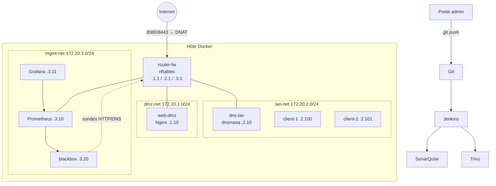

# Architecture

## Comment les zones communiquent
Chaque service ajoute au démarrage une route vers les autres zones **via router-fw** (`docker/common/set-routes.sh`).
Le routeur applique les règles nftables. La politique par défaut est `drop`.

## Chaîne CI/CD
Git → Jenkins (lint → SonarQube → build → Trivy → déploiement test + tests → validation manuelle → prod) → notification mail en cas d'échec.
